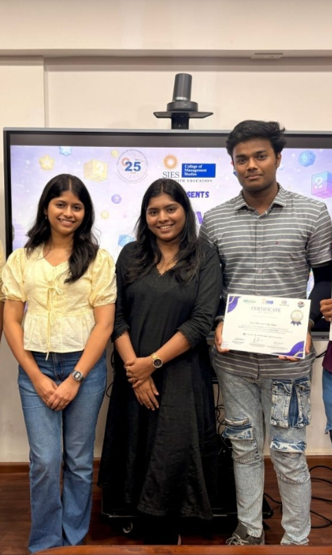

<div align="center">

<!-- 🌊 ANIMATED NEON HEADER BANNER -->


<br/>

<!-- ⌨️ ANIMATED TYPING EFFECT -->


<br/><br/>

<!-- 📊 PROFILE BADGES -->


<br/><br/>

<!-- 💻 DEVELOPER IDENTITY -->


</div>

---

<div align="center">
  
</div>

```bash
┌──(kaif㉿github)-[~]
└─$ whoami --verbose

╔══════════════════════════════════════════════════════════════════════╗
║  NAME       │ Khan Mohammad Kaif Shahid                             ║
║  GITHUB     │ Kaifkhan1212                                          ║
║  ROLE       │ Full Stack Developer | AI & XAI Enthusiast             ║
║  EDUCATION  │ MCA — BVIMIT (2025–2027)                              ║
║  GRADUATION │ BCA — CGPA 8.90                                       ║
║  ACHIEVEMENT│ 2nd Prize — Innov8 Hackathon 2026                     ║
║  FOCUS      │ Java, Python, Full Stack & Explainable AI              ║
║  MISSION    │ Build useful, understandable and reliable software    ║
╚══════════════════════════════════════════════════════════════════════╝

[+] Specialization ........ Full-Stack & Backend Application Development
[+] AI Interests .......... Explainable AI, NLP & LLM Integration
[+] Backend Stack ......... Spring Boot, FastAPI, Node.js & REST APIs
[+] Data Layer ............ PostgreSQL, MongoDB, Firebase & Supabase
[+] Currently Exploring .. Scalable architecture, cloud deployment & AI systems
[+] Ask Me About .......... Java, Python, React, APIs, databases & AI projects

[✓] Session established — welcome to my GitHub!
```

I’m an MCA student and developer who enjoys turning ideas into practical software. I build full-stack applications, AI-powered products and explainable AI systems, with a focus on clean implementation, useful features and real-world problem solving.

---

## 🟢 `GITHUB CONTRIBUTION STREAK`

<div align="center">

<!-- This is the only live stats card here; profile counters are shown once in the header. -->


</div>

---

## ⚔️ `TECH ARSENAL — TOOLS & TECHNOLOGIES`

<div align="center">

### 🌐 Frontend Engineering


<br/><br/>

### ⚙️ Backend Engineering


<br/><br/>

### 🗄️ Databases & Backend Services


<br/><br/>

### 🤖 AI, ML & LLM Integration


<br/><br/>

### ☁️ Cloud, DevOps & Developer Tools


<br/><br/>


</div>

---

## 🎯 `CURRENT MISSIONS`

```python
class KaifKhan:
    def __init__(self):
        self.name = "Khan Mohammad Kaif Shahid"
        self.role = ["Full Stack Developer", "AI & XAI Enthusiast"]
        self.languages = ["Java", "Python", "JavaScript", "TypeScript"]
        self.backend = ["Spring Boot", "FastAPI", "Node.js", "Express.js"]
        self.focus = [
            "Backend engineering and REST API development",
            "Explainable AI and applied machine learning",
            "Cloud deployment and database design",
            "Building reliable, user-focused applications"
        ]
        self.currently_learning = [
            "Scalable backend architecture",
            "Cloud deployment and production systems",
            "Applied AI and LLM integration"
        ]
        self.open_to = [
            "Software Engineering",
            "Full-Stack Development",
            "Backend Development",
            "AI Engineering"
        ]

    def say_hello(self):
        return "Let's build something useful and impactful!"

me = KaifKhan()
print(me.say_hello())
# Let's build something useful and impactful!
```

---

## 🚀 `FEATURED PROJECTS`

> A selection of my full-stack, backend engineering and AI projects.

---

### 🏆 DupliDetect — Multilingual Semantic Duplicate Detection

**🥈 2nd Prize — Innov8 Hackathon (Pixels 2026), among 60+ teams.**

An AI-powered solution that identifies semantically similar records across multilingual datasets using transformer embeddings and vector similarity search.

- Contributed to React frontend development and backend/ML integration.
- Integrated Sentence Transformers with FAISS for semantic similarity search.
- Used ONNX Runtime and FastAPI for efficient inference.

`React` `Python` `FastAPI` `Sentence Transformers` `FAISS` `ONNX Runtime`

<div align="center">
  
</div>
📂 **[GitHub Repository](https://github.com/Kaifkhan1212/DupliDetect-AI.git)**

---

### ☁️ CloudPMS — Cloud-Based Campus Placement Management System

A role-based placement management platform designed for Students, Placement Cell and Admin workflows.

- Developed placement management workflows and role-based dashboards.
- Integrated Amazon S3 for resume storage, Textract for text extraction and SES for email notifications.
- Deployed on AWS EC2 with Nginx and PM2, using MongoDB Atlas and HTTPS.

`React` `Node.js` `Express.js` `MongoDB Atlas` `AWS S3` `AWS Textract` `AWS SES` `Nginx` `PM2`

🚀 **[Live Demo](https://cloudpms.kaifkhan.in)** · 📂 **[GitHub Repository](https://github.com/Kaifkhan1212/CloudPMS-PlacementPortal)**

---

### 🩺 [KidneyXAI — Explainable AI Kidney Risk Assessment](https://github.com/Kaifkhan1212/KidneyXAI)

A full-stack explainable AI platform for chronic kidney disease risk assessment and lifestyle monitoring. It combines XGBoost predictions with TreeSHAP explanations to make model outputs easier to interpret.

- Developed the backend using Spring Boot and a Python FastAPI ML service.
- Integrated Supabase PostgreSQL for application data management.
- Implemented lifestyle tracking for ongoing patient monitoring.

`React` `Spring Boot` `Python` `FastAPI` `XGBoost` `TreeSHAP` `PostgreSQL`

🚀 **[Live Demo](https://kidney-xai.kaifkhan.in)** · 📂 **[GitHub Repository](https://github.com/Kaifkhan1212/KidneyXAI)**

---

### 💳 [ReconcileX — Payment Reconciliation Engine](https://github.com/Kaifkhan1212/ReconcileX)

A payment reconciliation engine that compares bank statements with internal transaction records to identify mismatches, duplicates, refunds and missing records.

- Implemented 13 matching rules for transaction comparison.
- Added Spring Security, JWT authentication and role-based access control.
- Developed the application using Java 21, Spring Boot, PostgreSQL and React.

`Java 21` `Spring Boot` `PostgreSQL` `React` `TypeScript` `Spring Security` `JWT` `Docker` `Flyway`

🚀 **[Live Demo](https://reconcilex.kaifkhan.in)** · 📂 **[GitHub Repository](https://github.com/Kaifkhan1212/ReconcileX)**

---

### 📄 [ResumeXAI — AI Resume Analyzer](https://github.com/Kaifkhan1212/ResumeXAI2.0)

An AI-powered platform that analyzes resumes against job descriptions and generates structured feedback with actionable improvement suggestions.

- Implemented JWT and Google OAuth authentication.
- Integrated Groq API with a FastAPI backend.
- Used PostgreSQL for application data management.

`React` `FastAPI` `PostgreSQL` `Groq API` `JWT` `Google OAuth`

🚀 **[Live Demo](https://resume-xai-2-0.vercel.app)** · 📂 **[GitHub Repository](https://github.com/Kaifkhan1212/ResumeXAI2.0)**

---

### 🌐 [MindBrief — Intelligent Web Summarizer](https://github.com/Kaifkhan1212/Web-Summarization)

A full-stack AI-powered web summarizer that extracts and synthesizes content from multiple sources into structured research briefs.

- Implemented content extraction using Cheerio and Mozilla Readability.
- Integrated Gemini API for AI-powered summarization.
- Developed the application using Next.js and Express.js.

`Next.js` `React` `TypeScript` `Node.js` `Express.js` `Gemini API` `Firebase`

🚀 **[Live Demo](https://mind-brief-ai-web-summarizer-caa6.vercel.app)** · 📂 **[GitHub Repository](https://github.com/Kaifkhan1212/Web-Summarization)**

---

### 🏥 [SehatLink — Rural TeleHealth Platform](https://github.com/Kaifkhan1212/SehatLink)

A telehealth platform connecting patients and doctors through role-based dashboards and real-time data synchronization.

- Developed patient and doctor workflows using React.
- Integrated Firebase Authentication and Firestore for real-time data management.
- Added Razorpay payment integration.

`React` `Firebase` `Firestore` `Razorpay`

🚀 **[Live Demo](https://sehat-link.vercel.app)** · 📂 **[GitHub Repository](https://github.com/Kaifkhan1212/SehatLink)**

---

### 🤖 [Jarvis AI Assistant — Voice-Enabled AI Dashboard](https://github.com/Kaifkhan1212/Jarvis-AI-Assistant)

A voice-enabled AI assistant featuring streaming responses, conversational interaction and local command capabilities.

- Integrated Groq-powered conversational responses.
- Used FastAPI and WebSockets for real-time communication.
- Implemented wake-word detection and text-to-speech interactions.

`Python` `FastAPI` `Groq API` `WebSockets`

📂 **[GitHub Repository](https://github.com/Kaifkhan1212/Jarvis-AI-Assistant)**

---

<div align="center">

**More projects and development updates coming soon.**

</div>

---

## 🏆 `ACHIEVEMENTS & RECOGNITION`

<div align="center">

| 🎖️ Achievement | Recognition |
|:---|:---:|
| Innov8 Hackathon — Pixels 2026 | 🥈 2nd Prize · 60+ teams |
| NPTEL — Programming in Java | Elite + Silver · 83% |
| NPTEL — Cloud Computing | Elite Certification |
| Oracle Certified Foundations Associate | Agentic AI |
| ICET 2026 | Presented research paper — “SafeGuard AI” |
| QUASTECH | Certificate of Appreciation — BVIMIT Job Fair contribution |

</div>

---

## 📊 `ENGINEERING FOCUS`

```text
╔══════════════════════════════════════════════════════════════════════╗
║  ENGINEERING FOCUS — KAIFKHAN1212                                  ║
╠══════════════════════════════╦═══════════════════════════════════════╣
║  Full-Stack Development      ║  React · Next.js · REST APIs         ║
║  Backend Engineering         ║  Java · Spring Boot · FastAPI        ║
║  Database Engineering        ║  PostgreSQL · MongoDB · Firebase     ║
║  AI & Explainable AI         ║  XGBoost · SHAP · Transformers       ║
║  LLM Integration             ║  Gemini API · Groq API               ║
║  Cloud & Deployment          ║  AWS · Vercel · Render · Docker      ║
╚══════════════════════════════╩═══════════════════════════════════════╝
```

---

## 🤝 `OPEN TO COLLABORATE & OPPORTUNITIES`

- Full-stack and backend application development.
- AI-powered products, explainable AI and applied NLP.
- Cloud-deployed academic and real-world software projects.
- Hackathons and open-source collaboration.

**Currently open to:** Software Engineering, Full-Stack Development, Backend Development and AI Engineering opportunities.

---

## 🌐 `CONNECT WITH ME`

<div align="center">

<a href="mailto:kaif01450@gmail.com">
  
</a>
<a href="https://www.linkedin.com/in/kaifkhan01/">
  
</a>
<a href="https://github.com/Kaifkhan1212">
  
</a>
<a href="https://www.kaifkhan.in/">
  
</a>

</div>

---

## 🐍 `CONTRIBUTION SNAKE`

<div align="center">

<picture>
  <source media="(prefers-color-scheme: dark)" srcset="https://raw.githubusercontent.com/Kaifkhan1212/Kaifkhan1212/output/github-contribution-grid-snake-dark.svg" />
  <source media="(prefers-color-scheme: light)" srcset="https://raw.githubusercontent.com/Kaifkhan1212/Kaifkhan1212/output/github-contribution-grid-snake.svg" />
  
</picture>

</div>

---

<div align="center">

### 💬 `A DEVELOPER'S NOTE`

*“Build software that solves real problems. Build AI that people can understand. Keep learning, keep shipping.”*

<br/>

<!-- 🌊 KAIF KHAN ANIMATED FOOTER -->
<p align="center">
  
</p>

</div>
